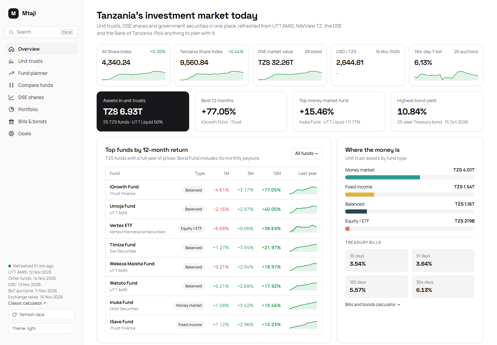
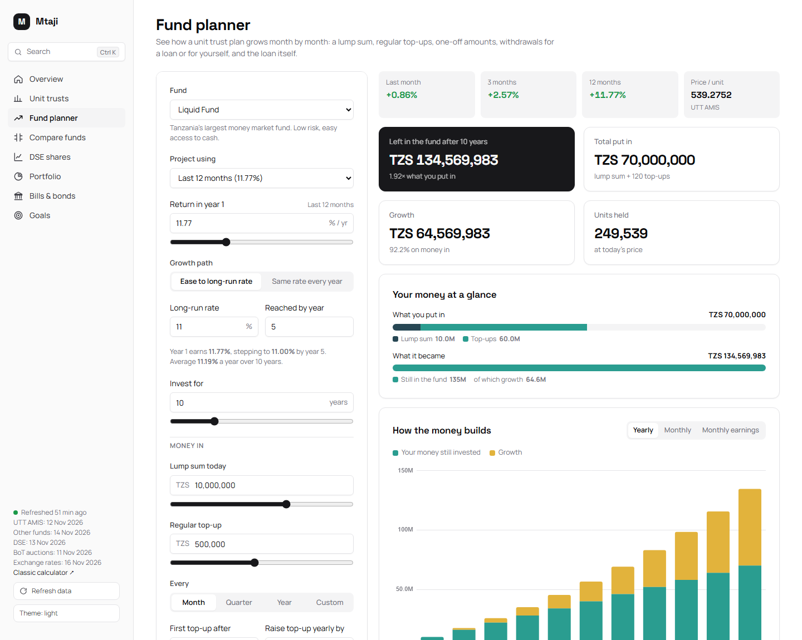
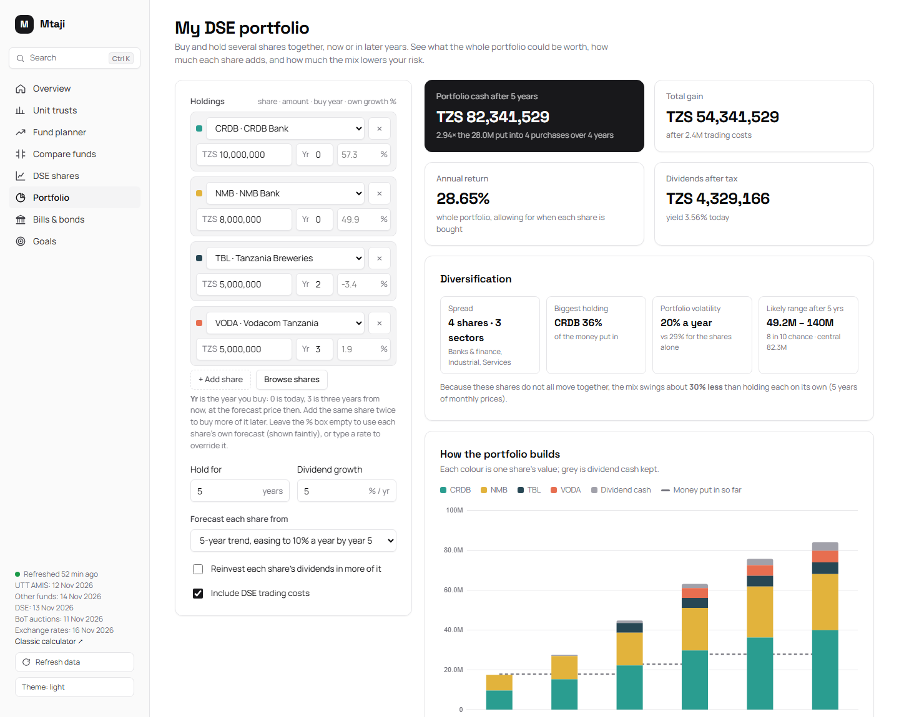
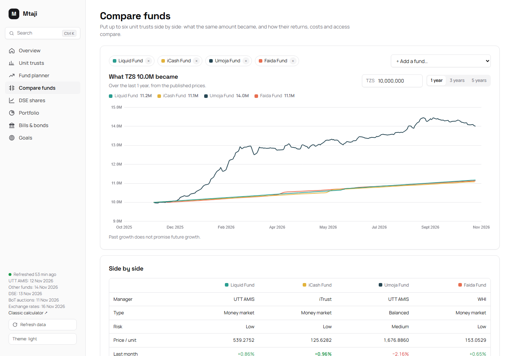
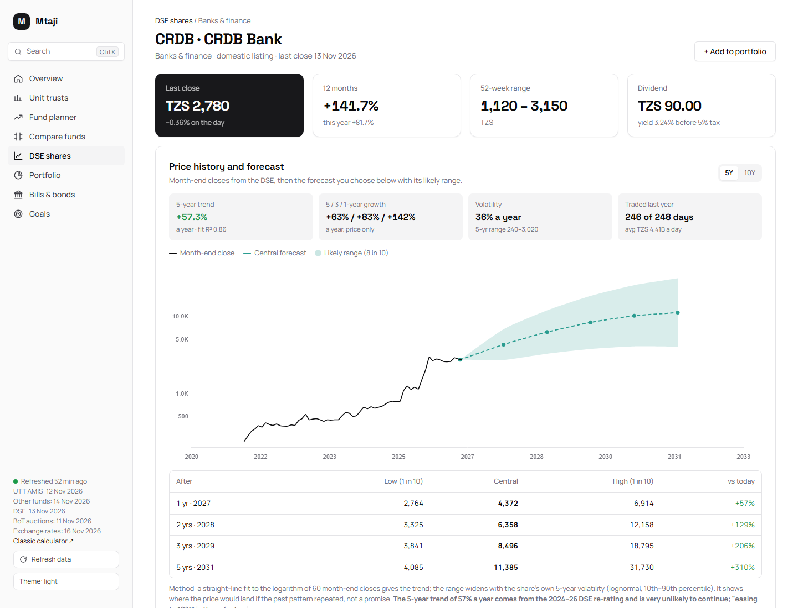
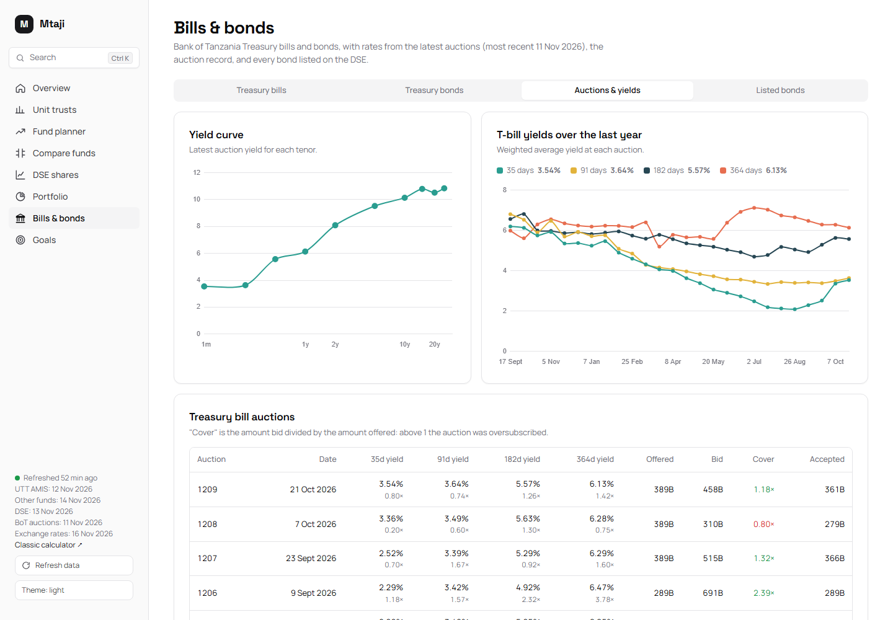
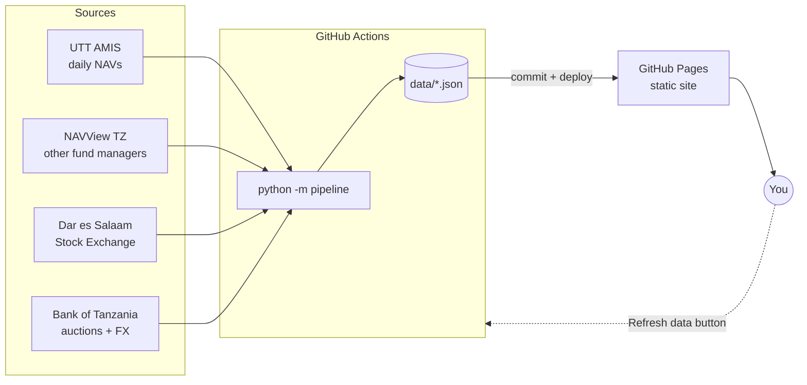

<div align="center">

# Mtaji

**A Tanzania investment planner. It shows unit trusts, DSE shares and Bank of Tanzania securities with live data, and plans with them.**

[**Open Mtaji →**](https://albertmwangwa.github.io/mtaji/) · [Classic calculator](https://albertmwangwa.github.io/mtaji/legacy/) · [How the data refresh works](#how-the-data-stays-fresh)

[](https://github.com/albertmwangwa/mtaji/actions/workflows/site.yml)


<picture>
  <source media="(prefers-color-scheme: dark)" srcset="docs/screenshots/overview-dark.png">
  
</picture>

</div>

## What you can do

| | |
|---|---|
| **Overview** | A market strip with the DSE indices, market value, USD/TZS and the 364-day T-bill, each with a 1-year sparkline. Below it: unit trust assets, the top funds and the DSE movers. |
| **Unit trusts** | All 28 schemes from UTT AMIS, iTrust, Orbit, Sanlam, Vertex, Zan, WHI and others. Each fund shows its price history and returns, and a "what if I had invested" check based on real prices. |
| **Compare funds** | Up to 6 funds on one chart, showing what the same amount became over 1, 3 or 5 years. A table compares returns, size, fees, exit charge, minimum and how fast you get your money back. |
| **Fund planner** | A lump sum, top-ups, one-off amounts, and withdrawals you mark as **loan payment** or **personal use**. It also covers a salary loan. Views by year, by month, and month by month showing the compounding, plus a loan path and the same plan in every other fund. |
| **DSE shares** | All 28 listed companies, the five indices and the listed ETFs (price against NAV). Each share has up to 10 years of history, a forecast with a likely range, dividends and a buy-and-hold calculator. |
| **Portfolio** | Several shares held together, **each bought in the year you choose**. It shows the total result, each share's contribution, a money-weighted annual return, and how much the mix lowers your risk. |
| **Bills & bonds** | Calculators fed by the latest BoT auction for each tenor, the yield curve, a year of T-bill yields, every recent auction with its cover ratio, and all 212 bonds listed on the DSE. |
| **Goals** | What a saving plan grows to, or how much you need to save to reach a target, also shown in today's shillings. |

Press <kbd>Ctrl</kbd> + <kbd>K</kbd> (or <kbd>/</kbd>) anywhere to jump to a fund, share or page. Light and dark themes follow your system, or you can choose one.

## A closer look

<table>
<tr>
<td width="50%"><b>Fund planner</b><br>Month-by-month compounding, top-ups, and withdrawals that go to a loan or to you.<br><br></td>
<td width="50%"><b>Portfolio</b><br>Buy shares now or in later years. The dashed line is the money put in so far.<br><br></td>
</tr>
<tr>
<td><b>Compare funds</b><br>What TZS 10M became in each fund, from the published prices.<br><br></td>
<td><b>DSE share</b><br>History, a forecast with its likely range, dividends and buy-and-hold.<br><br></td>
</tr>
<tr>
<td colspan="2"><b>Bills &amp; bonds</b><br>The yield curve and a year of T-bill yields from Bank of Tanzania auctions, with every auction's cover ratio.<br><br></td>
</tr>
</table>

## How the data stays fresh



1. **On a schedule:** at 09:17 EAT Monday to Saturday (after UTT AMIS publishes NAVs), 16:47 EAT on weekdays (after the DSE closes) and 21:23 EAT on Wednesdays (after BoT auction results). The workflow runs `python -m pipeline`, commits the new `data/` files and republishes the site. It runs on GitHub's servers, so no computer needs to be on.
2. **Whenever you want:** click **Refresh data** in the sidebar (the round arrow button on phones). It starts the same workflow, shows each step, and loads the new figures into the open page when they are live, usually 4 to 6 minutes later.
   - The first time, the button asks for a fine-grained GitHub token limited to this repository, with **Actions** set to **Read and write**.
   - The token is kept only in that browser's localStorage and is never part of the site.
   - Visitors without a token can use **Load latest data**.
3. **If a source is down:** its last good file is kept and the failure is recorded in `data/meta.json`. The sidebar then shows "1 source failed"; hover over it to see which.

You can also start a refresh from the repository's **Actions** tab → **Refresh data and deploy** → **Run workflow**, or run `python -m pipeline` locally and push. Run `git pull` before working locally, because each refresh adds commits.

### Sources

| Source | What it provides |
|---|---|
| **UTT AMIS** | The full official daily NAV history (sale and repurchase prices, fund size), from the endpoint behind uttamis.co.tz/fund-performance. |
| **NAVView TZ** | The latest NAV, returns and size for the other managers. Each run appends that day's NAV, so daily history builds up for these funds. |
| **DSE** | Each company's full trading history and dividend notices, and the market watch (today's session, 15 minutes delayed, and market values). Also all five indices, total market value, the price of every listed security (ETFs included) and the listed government and corporate bonds. NMB is adjusted for its 1-for-10 split (prices divided by 10 and volumes multiplied by 10 before 24 Aug 2026; the chart marks the split). One-off bad prints are dropped and logged. The 52-week range uses closing prices. Shares that have not traded on the DSE in a year (EABL, Kenya Airways, Uchumi, Swala) are labelled as reference prices and get no forecast. |
| **Bank of Tanzania** | The last 26 T-bill and 36 T-bond auctions (yields, prices, amounts offered and bid, ISIN, maturity), plus daily exchange rates for 43 currencies. A tenor with no recent auction keeps its last figure, marked as an estimate. |

Returns (1M, 3M, YTD, 12M, 3Y and 5Y a year, and since launch) are computed once, in `pipeline/build.py`. The Bond Fund's figures include its TZS 1.00 monthly payout. **New listings** go in `pipeline/config/dse.json`; **new funds** go in `pipeline/config/funds.json`, keyed by their NAVView id.

## Project layout

```
index.html              app shell (no build step)
assets/app.css          design system: shadcn/ui zinc tokens, Manrope + Space Grotesk, light/dark
assets/js/main.js       navigation, hash routing (#/funds/utt.bond, #/shares/CRDB, ...), quick search
assets/js/data.js       loads data/*.json
assets/js/engine/       the maths: sim.js (compounding), loan.js, dse.js (fees, forecast, portfolio), treasury.js
assets/js/views/        one module per page
assets/js/lib/          formatting, form binding, charts (Chart.js 4.4.1), refresh.js (the Refresh data button)
data/                   generated by the pipeline (only the 'tax' block in treasury.json is set by hand)
pipeline/               Python 3.10+, standard library only
  sources/              utt.py, navview.py, dse.py, bot.py
  build.py              returns, split adjustment, bad-print filter, dividends, liquidity
  config/               facts the sources don't publish: fund type, fee, minimum, payouts; DSE tickers and splits
legacy/                 the original single-file calculator (served at /legacy/)
docs/screenshots/       images used in this README
```

## Run it locally

```bash
python -m pipeline          # refresh everything (about 3 minutes); or: python -m pipeline funds | dse | treasury
python -m http.server 8000  # then open http://localhost:8000
```

The pages load JSON with `fetch`, so open them through a local server, not straight from disk.

## Hosting

**GitHub Pages (how this repository runs).** In **Settings → Pages**, set **Source** to **GitHub Actions**. `.github/workflows/site.yml` deploys on every push and refreshes the data on the schedule above. If a Tanzanian site ever blocks GitHub's US-based runners, the failure shows in the sidebar and the last good data stays in place. You can then run the pipeline locally and push, or use a self-hosted runner.

**Cloudflare Pages or Netlify.** Connect the repository with no build command and the repository root as the output directory. Keep the GitHub Actions workflow for the data refresh: each data commit triggers a redeploy.

## Notes on the maths

- **Unit trusts** compound monthly at (1 + yearly rate)^(1/12) − 1. "Ease to long-run" steps from the starting rate to the long-run rate for the fund's type: money market 11%, fixed income 11.5%, balanced 13%, equity 14%.
- **DSE forecast (the Mtaji model, `pipeline/model.py`):** rebuilt from each share's full DSE history at every refresh.
  - *Expected growth* is the share's own long-run growth (up to 10 years) pulled towards the DSE-wide median, more strongly when its history is short or volatile, so one strong run is not assumed to repeat.
  - *Ranges* (next session, week, month, 3 months, 1, 2, 3 and 5 years) come from the share's own past moves over the same period and are sized to hold 8 times in 10. The next session stays inside the DSE price cap (Rule 212: ±15%, ±5% or ±2%).
  - *Tested honestly:* tuned on 2019–2022, then checked on 2023 onwards. The ranges held 72% of the time a session ahead, 65% a month ahead and 51% a year ahead, short of 80% because the 2024–26 re-rating was bigger than anything earlier. The central forecast was no more accurate than assuming no change, so the page tells you to read the range. Each share page shows its own test results.
  - *Today's close:* the DSE close is the volume-weighted average of the session's trades (Rule 203), so once a session starts, the close is bounded by the day's high and low from the 15-minute-delayed market watch. The public feed does not publish traded prices during the session.
  - *Worth more than a T-bill?* The chance that holding the share (price plus dividends after 5% tax) beats rolling 364-day T-bills over 1, 3 and 5 years.
- **Portfolio:** a share bought in a later year is bought at the forecast price for that year and earns dividends only from then on. The portfolio's annual return is money-weighted (an IRR over the yearly cash flows), so money put in later counts for less time. Diversification uses the covariance of 5 years of monthly returns.
- **Trading costs:** brokerage of 1.7% on the first TZS 10M of a trade, 1.5% on the next 40M and 0.8% above that, plus 18% VAT. On top come DSE 0.14%, CMSA 0.14%, Fidelity Fund 0.02% and CDS 0.06% (plus VAT). That is about 2.38% each way on a trade under TZS 10M. 5% tax is withheld on dividends.
- **Loans:** interest is charged monthly on the reducing balance. A withdrawal marked as a loan payment either keeps the deduction and finishes the loan sooner, or keeps the end date and lowers the deduction.

> Past returns do not promise future returns. Projections are illustrations, not financial advice.
